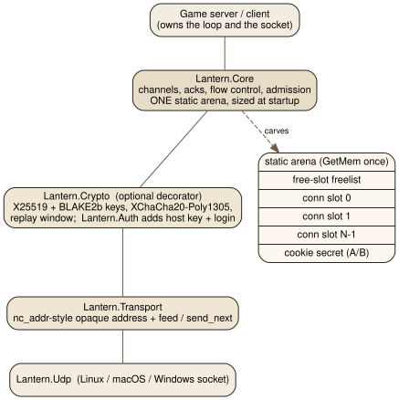
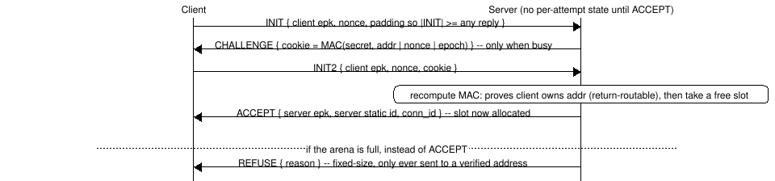

## Introduction

The C projects in this series each answered one question. [Netchan](/netchan/)
asked what a near-minimal reliable-UDP layer looks like. [netchan-v2](/netchan-v2/)
cut a transport seam so the same core could run somewhere other than a POSIX
socket. [netchan-v3](/netchan-crypto/) added encryption as a decorator, and
[netchan-v4](/netchan-auth/) added peer authentication. [Netchan on
IPX](/netchan-ipx/) rebuilt the core as `microchan`: a fully static, no-malloc
subset for a 16-bit DOS machine, where every buffer is allocated once at startup
and nothing touches the heap during a match.

This article designs a new library rather than porting an old one. The target is
FreePascal on Linux, macOS, and Windows. The use case is a small game: 128 or
fewer players, mostly on a LAN, where one copy of the game hosts a server or a
persistent dedicated server is left running, and every other copy connects to
it. None of the wire formats need to be compatible with netchan. This is a clean
start that keeps what the four projects taught and drops what they only needed
for their own constraints.

The name here is **Lantern**. A server lights one on the LAN, a small beacon that
advertises the game and its address, so the other copies find it without anyone
reading an IP address aloud. Discovery is the first thing the library does, and
it is where the LAN-first use case shows most clearly; the reliable and
unreliable channels carry the game once a player has found the server and
connected.

Three requirements shape every decision below:

1. **Total allocation is static and start-time configurable.** The server names
   its limits when it starts, the library allocates exactly one block, and after
   that it never calls the heap. A server that wants to support 8 players should
   pay for 8, not 128.
2. **Refusing a connection is cheap and hard to abuse.** When the arena is full,
   or when a flood arrives, the server must spend almost nothing to say no, and
   an attacker must not be able to turn the server into a packet amplifier or
   exhaust its memory with half-open connections.
3. **The IDL is Pascal's.** The message description language is compiled by a
   tool written in FreePascal, and its syntax reads like Pascal source rather
   than like the awk-driven `microser` the C projects used.

## Abstract

Lantern is a reliable and unreliable multiplexed channel library for FreePascal.
The core is transport-agnostic: the application owns the socket and the loop,
feeds received datagrams in and pulls datagrams to send out, exactly as
`microchan` does. All state lives in a single arena whose size is computed from a
start-time configuration record and allocated once, so the server's memory and
per-tick work scale with the number of connections it chose to support, not with
a compile-time maximum.

Admission is governed by a stateless return-routability handshake modeled on
QUIC's Retry and WireGuard's cookie reply. The server holds no per-attempt state
until a client has proved it can receive at its claimed address, which both
defeats spoofed-source floods and makes a full server's refusal safe to send.
Confidentiality and authentication are additive decorators, reused in shape from
netchan-v3 and netchan-v4: an X25519 ephemeral handshake with BLAKE2b-derived
directional keys and XChaCha20-Poly1305 per packet, an optional long-term host
key verified trust-on-first-use through a `known_hosts` file, and a login step
that offers an Ed25519 public key or a password.

Messages are described in a Pascal-flavored IDL and compiled to FreePascal
records and serializers by `lanterngen`, a standalone tool written in FreePascal.
The wire format carries field tags so that a client and a server built from
different revisions of a schema interoperate within a minor version.

## Findings

### What Each Predecessor Taught

The design is almost entirely a matter of selection. Each project contributed a
rule; the new constraints decided which rules to keep and which to change.

| Project | Contribution | Kept in Lantern |
|---|---|---|
| netchan | Multiplexed reliable + unreliable channels, app-owned socket, connection-id demux, per-channel flow control | Yes, as the core model |
| netchan | `malloc` on demand, fragmentation, a 64-slot reorder buffer | No. Static arena, one message per packet |
| netchan-v2 | An opaque address plus `feed`/`send_next`, so a new transport is a new file | Yes, as the transport seam |
| microchan | Fully static, no-heap, one-packet messages, peer pool routed by `peek_id`, a redirect event for lobby-to-host handoff | Yes, with tunables moved to start time |
| netchan-v3 | A Noise/WireGuard-shaped encryption decorator the core never sees | Yes, as `Lantern.Crypto` |
| netchan-v4 | A server host key, TOFU `known_hosts`, an ssh-shaped login | Yes, as `Lantern.Auth` |

Two lessons are less visible because they were learned as bugs, after the
articles were first published. They are baked into this design from the start.

**One clock, owned by the caller, passed to every entry point.** The original
netchan stamped receive and send times from its own internal clock while the
service routine compared them against a timestamp the caller sampled a moment
earlier. When the monotonic clock advanced a millisecond between those two
reads, an unsigned subtraction underflowed and a brand-new connection tripped
its own idle timeout. The fix was to make every entry point take the same
`now_ms`. Lantern starts there: `Feed`, `SendNext`, and `Service` all take the
caller's monotonic millisecond clock, and the library reads no clock of its own.

**A handshake must survive a single lost packet.** The original netchan could
strand a client forever if one `CONNECT_ACCEPT` was dropped, because the server
had already moved on and ignored the retransmitted init. Lantern's admission
logic re-sends the accept when the established peer repeats its init, treats a
repeated accept as idempotent, and refuses to let a stray or mismatched id
disturb a live connection.

### Discovery: The Beacon

A LAN game should not make a player type an address. The server lights a beacon:
every second or two it broadcasts a small datagram on a well-known UDP port, and
any client on the subnet that is listening builds a list of the games it can
see. The beacon carries only what a player needs to choose a server and what a
client needs to reach it: a magic number and protocol version, a game id, a
human name, the current and maximum player counts, the listen address and port,
and the fingerprint of the server's host key. There is no central registry; the
light simply reaches as far as the broadcast does.

The beacon is cheap and hard to abuse for the same reason the LAN model is
narrow. It is unsolicited and small, so it elicits nothing larger than itself
and cannot be used to amplify. It is scoped to the link, a subnet broadcast or a
multicast group with a TTL of one, so it never leaves the LAN. A server that
also wants to answer a unicast probe may, but the reply is never larger than the
probe and is rate-limited per source, which keeps the server from becoming a
reflector. The host-key fingerprint in the beacon lets a client recognize a
server it has connected to before, though a beacon on a hostile LAN can be
forged, so the fingerprint is a hint that the `NX` handshake below still
verifies for real. This is the upstream netchan project's `nc_beacon` idea,
carried into a library whose name it earns.

Off the LAN, discovery does not apply: a persistent dedicated server is reached
by a known address or an out-of-band list, not by a broadcast. Finding internet
servers is a master-server problem, discussed as a non-goal near the end.

### The Static Arena

Lantern allocates one block at startup and never again. The size is not a
compile-time constant as it was in `microchan`; it is computed from a
configuration record the caller fills in.

```pascal
type
  TLanternConfig = record
    MaxConns   : Word;     { connection slots to reserve }
    MTU        : Word;     { datagram payload budget, e.g. 1200 }
    SendWindow : Word;     { in-flight reliable messages per channel }
    RecvWindow : Word;     { reorder/hold slots per reliable channel }
    MaxChan    : Byte;     { channels multiplexed per connection }
    UnrelTxq   : Byte;     { queued unreliable datagrams per channel }
  end;
```

From this, the library computes a total byte count, calls `GetMem` once, and
carves every connection slot, channel buffer, send window, and receive queue out
of that block with an internal bump allocator and a free-slot freelist. A slot is
taken from the freelist on admission and returned on close. There is no
`GetMem` after startup, so the process cannot fragment its heap or fail an
allocation in the middle of a match, which was the whole point of the DOS build
carried forward to a modern one.

The payoff is that cost tracks the configuration. A rough per-connection size is

```
per_conn  ~=  sizeof(conn bookkeeping)
            + MaxChan * ( SendWindow*MTU + RecvWindow*MTU + UnrelTxq*MTU )
total     ~=  sizeof(server) + cookie_secret + MaxConns * per_conn
```

With `MTU = 1200`, `SendWindow = 8`, `RecvWindow = 8`, `MaxChan = 2`,
`UnrelTxq = 4`, one connection needs roughly 48 KB of buffers plus a little
bookkeeping. That makes the whole-server footprint a straightforward dial:

| Players | Buffer RAM (approx.) | Suits |
|---|---|---|
| 8 | ~0.4 MB | a game hosting its own small match |
| 32 | ~1.6 MB | a LAN party |
| 128 | ~6.4 MB | a persistent dedicated server at the stated ceiling |

A server admin who wants to cap memory or per-tick work sets `MaxConns` lower and
pays less. The reliable windows dominate the figure, so a game that sends mostly
unreliable state can shrink `SendWindow` and `RecvWindow` and pay far less again.



### Admission: Cheap to Refuse, Hard to Abuse

The second requirement is the interesting one. A server that allocates state the
moment an `INIT` arrives can be drowned in half-open connections from spoofed
addresses, and a server that answers an unverified packet with a larger packet
becomes a reflector that amplifies an attacker's traffic at a victim. Lantern
avoids both by holding no per-attempt state until the client proves it can
receive at the address it claims. The mechanism is a stateless cookie, the same
idea as QUIC's Retry token and WireGuard's cookie reply.



The rules that make it safe:

- **The first client packet is padded.** An `INIT` must be at least as large as
  the largest reply the server might send to it. An attacker therefore cannot
  spend a small spoofed packet to elicit a large one. There is no amplification
  because the request is never smaller than the response.
- **The challenge is stateless.** The cookie is `MAC(secret, client_addr |
  nonce | epoch)`, where `secret` is a random key held in the arena and rotated
  on a schedule (two generations kept, so a cookie issued just before a rotation
  still verifies). Computing and checking it is one MAC and no allocation. The
  server remembers nothing between the challenge and the reply.
- **State is allocated only after return-routability is proved.** When the
  client echoes the cookie in `INIT2`, the server recomputes the MAC. A matching
  cookie means the client actually received the challenge at its claimed
  address, so the address is not spoofed. Only now does the server take a slot
  from the freelist.
- **Refusal is a fixed-size packet sent only to a verified address.** If the
  freelist is empty, the server sends a small `REFUSE` instead of an `ACCEPT`.
  Because the client has already proved return-routability, a `REFUSE` cannot be
  reflected at a victim, and because it is a constant size no larger than the
  request, it cannot amplify. Checking capacity is an O(1) freelist test.

The challenge round trip is adaptive, following QUIC's lead. When the server is
idle and far below capacity it can accept an `INIT` directly and skip the
challenge, so a LAN client pays no extra round trip in the common case. The
server demands the cookie only once its new-connection rate or its occupancy
crosses a threshold, which is exactly when a flood would otherwise hurt. Under
attack the cost per spoofed packet is one MAC and zero memory; a real client
pays one extra sub-millisecond round trip on a LAN.

This admission layer is separate from encryption. The `INIT` already carries the
client's ephemeral public key and the `ACCEPT` carries the server's, so the same
packets that gate admission also start the X25519 handshake described next. The
cookie protects the server's memory; the handshake protects the conversation.

### Encryption and Authentication, Reused in Shape

Because the transport is a seam, confidentiality and authentication are additive,
exactly as they were in the C series. The application talks to the core; the
core produces plaintext datagrams; `Lantern.Crypto` seals them after `SendNext`
and opens them before `Feed`; the transport carries sealed bytes. The core never
learns that it is encrypted.

The primitives are the ones netchan-v3 settled on, and there is no reason to
reopen that argument here:

- One **X25519** ephemeral exchange per connection. Each side sends its public
  half; the shared secret is combined with **BLAKE2b** into one directional key
  per direction, with the two public keys sorted before hashing so both peers
  derive the same pair regardless of who connected.
- **XChaCha20-Poly1305** per packet, with a 64-bit counter nonce, so every
  datagram is independently decryptable, which a datagram protocol requires and
  a TLS-style chained stream cipher cannot give.
- An **RFC 6479 sliding replay window**, so a captured packet replayed later is
  rejected.
- An optional **pre-shared key** folded into the key derivation for a closed
  game, giving confidentiality against anyone without the group secret.

Authentication is netchan-v4's design. The server holds a long-term X25519
**host key**. It is carried in the handshake as a static identity, authenticated
by the `es` Diffie-Hellman step rather than by a signature, which is Noise's
`NX` pattern and costs no extra round trip and no bytes on the wire beyond the
key itself. A client verifies the host key trust-on-first-use against a
`known_hosts` file and prints a loud warning if a remembered server's key ever
changes. On top of that sits a login step where the client offers an **Ed25519**
public key, signing a digest that includes the session id so a signature cannot
be replayed to a different server, and falls back to a password only if asked.

For a FreePascal implementation these primitives come from binding
[Monocypher](https://monocypher.org/), the same small public-domain C library
whose `crypto_blake2b` and X25519 routines the netchan projects used. It is a
single C file, trivially linked into an FPC program, which keeps the audited
crypto out of Pascal and leaves only the protocol glue to write. A pure-Pascal
port is possible later if a dependency-free build matters more than reusing
vetted code.

A LAN game among trusted machines can leave the whole stack off and run the
plaintext core. The point of the seam is that turning encryption on is a
configuration choice and a linked unit, not a rewrite.

### The Channel Model and Large Transfers

A connection multiplexes a small fixed number of channels, each either reliable
or unreliable, following netchan and microchan. The expected shape for a game is
one reliable channel for events that must arrive, such as the join handshake,
chat, and score changes, and one unreliable channel for state snapshots that
expire in milliseconds and should never wait behind a retransmission. The
default `MaxChan` of 2 covers this; a game that wants more can raise it and pay
the arena cost.

Lantern keeps microchan's rule that **one application message fits one packet**.
The largest message is `MTU` minus the packet and record headers, and the core
never fragments or reassembles. This is the single biggest simplification over
the netchan core, which carried fragmentation and a 64-slot reorder buffer to
stitch large messages back together.

The cost is that streaming something large to a joining client, such as a
generated map or a level, is the application's job. The application splits the
map into message-sized chunks and sends them over a reliable, ordered channel;
the receiver reassembles them. This is the pattern the netchan-v2 demo already
used for its map stream, and it keeps the protocol core small and its buffers
bounded. For a LAN game whose maps are a handful of kilobytes, a short burst of
reliable chunks is more than fast enough, and the application knows better than
the transport when a transfer may be dropped or deferred.

### A Pascal IDL and a Pascal Tool

The largest departure from the C series is the message description language. The
C projects described messages in `microser`, a format processed by an awk
script, with a syntax of its own. Lantern describes them in a language that reads
like FreePascal and compiles them with `lanterngen`, a standalone tool written in
FreePascal. A project that already builds Pascal gains no new language runtime to
describe its wire format, and the schema looks like the code it generates.

A schema is a unit. It declares enums and messages; a message is a record of
tagged fields and may carry a Pascal-style variant part selected by a
discriminant. The number in brackets after each field is its **wire tag**, not
its position, and it is the mechanism that lets a client and a server built from
different revisions interoperate: a reader skips a tag it does not know and
treats a message that ends early as having the default values for the missing
fields.

```pascal
unit GameProto;

type
  { An enum names its wire values explicitly. }
  MsgKind = (Join = 1, Snapshot = 2, Chat = 3, Bye = 4);

  { A plain message: three tagged fields. bytes and string are
    length-prefixed and decode as a view into the input buffer. }
  JoinReq = message
    name    : string [1];
    version : uint16 [2];
    wantTeam: uint8  [3];
  end;

  { A variant message: the reader learns the present arm from the
    discriminant, exactly like a Pascal variant record. }
  ServerMsg = message
    tick : uint32 [1];
    case kind: MsgKind [2] of
      Snapshot: ( players: uint8  [3];
                  state  : bytes  [4] );
      Chat:     ( fromId : uint16 [5];
                  text   : string [6] );
      Bye:      ( reason : uint16 [7] );
    end;
  end;

  { A dispatch table multiplexes several messages on a leading tag byte,
    so a receiver can demux without guessing. }
  dispatch Protocol
    1: JoinReq;
    2: ServerMsg;
  end;
```

The scalar types are the fixed-width integers (`uint8` through `int64`), `bool`,
the floats (`float32`, `float64`), `bytes`, and `string`. The grammar is small
enough to state directly:

```ebnf
unit      = "unit" ident ";" "type" { decl } .
decl      = enumdecl | msgdecl | dispdecl .
enumdecl  = ident "=" "(" enumval { "," enumval } ")" ";" .
enumval   = ident "=" number .
msgdecl   = ident "=" "message" { field } [ variant ] "end" ";" .
field     = ident ":" type "[" number "]" ";" .
variant   = "case" ident ":" ident "[" number "]" "of" { arm } "end" ";" .
arm       = ident ":" "(" field { field } ")" ";" .
dispdecl  = "dispatch" ident { number ":" ident ";" } "end" .
type      = "uint8" | "int8" | ... | "bool" | "float32" | "float64"
          | "bytes" | "string" | ident .
```

`lanterngen schema.pidl -o SchemaProto.pas` emits, for each message, a `packed
record` and a pair of routines:

```pascal
function EncodeJoinReq(var Buf; Cap: SizeInt; const M: JoinReq): SizeInt;
function DecodeJoinReq(const Buf; Len: SizeInt; out M: JoinReq): Boolean;
```

`Encode` returns the number of bytes written, or a negative error if the message
does not fit `Cap`, so the caller can fail cleanly instead of overrunning a
packet. `Decode` returns `False` on a malformed input and otherwise fills `M`,
leaving any field the writer omitted at its default and skipping any tag it does
not recognize. `bytes` and `string` fields are returned as a pointer and a
length into the original buffer, so decoding copies nothing; the caller consumes
them before the buffer is reused. A `dispatch` declaration additionally emits a
reader that peeks the leading tag and calls the matching `Decode`.

The wire encoding is deliberately plain. Integers are little-endian, which every
target CPU is, so the hot path does no byte-swapping. Each field is written as
its tag and its value; `bytes` and `string` are a length prefix and the raw
octets. There is no self-describing type information on the wire beyond the tag,
because both ends share the schema. This is the same forward-compatibility
contract the serialization survey called the floor of a good binary format: old
readers tolerate new fields, and a truncated message is read as far as it goes.

The tool itself is small and has no dependencies beyond the FreePascal runtime,
which matters for the three-platform target: `lanterngen` is a lexer, a
recursive-descent parser over the grammar above, and an emitter, built by the
same `fpc` invocation as the rest of the project and run in CI on Linux, macOS,
and Windows. There is no awk, no second language, and nothing to install.

### Cross-Platform Notes

The core is portable FreePascal and endian-fixed, so it is the same on every
target. Only the optional `Lantern.Udp` helper touches the operating system, and
it is thin because the application, not the library, owns the socket. On Linux
and macOS it is a non-blocking `recvfrom`/`sendto` over the `Sockets` and
`BaseUnix` units; on Windows it is the same over WinSock2. The `nc_addr`-style
opaque address keeps the core from ever naming a `sockaddr`, so the per-platform
code is confined to packing and unpacking an address and draining a socket,
which is a page of code guarded by `{$IFDEF}`. Nothing in the protocol, the
arena, or the IDL output varies by platform.

## Streaming a Server's Assets

A server often owns content a joining client needs before it can play: a
generated map, a 3D model, a texture, a set of sounds. There are two honest ways
to get that content to the client, and the choice is mostly a question of size.
Neither should push fragmentation or a download subsystem into the small
protocol core.

### What the Channels Give You Today

Nothing new is required to move an asset right now. The application splits it
into message-sized chunks, each at most `MTU` minus the headers, and sends them
over a reliable, ordered channel; the receiver concatenates them in order. The
reliable send window bounds how many chunks are in flight at once, so the
throughput ceiling is roughly `SendWindow * MTU / RTT`. On a LAN the round trip
is a fraction of a millisecond, so even the default window of eight saturates a
link, and a few-kilobyte map arrives in well under a second. A game that needs a
higher ceiling raises `SendWindow` and pays the arena cost for it.

The limits of in-band transfer are real but modest at LAN sizes. The chunks share
the connection with game traffic, though the multiplexed channels and per-channel
flow control keep snapshots flowing past a transfer rather than behind it. There
is no built-in integrity check beyond the transport's, and a client that drops
and reconnects starts the download over. For small, server-generated,
per-match content this is the right amount of machinery: none.

### A Thin Asset-Transfer Helper

To make in-band transfer easier without touching the core, add a helper unit that
formalizes the hand-rolled chunking. It is an optional layer above the channel
API, and its messages are defined in the IDL like any others:

- An **offer** message: `{ assetId, totalSize, chunkSize, blake2bHash }`.
- The receiver opens a dedicated reliable channel, acknowledges progress, and
  can **resume** from a chunk offset if the connection drops and re-opens, which
  is the one thing raw chunking does not give you.
- A **progress** callback, so the game can draw a loading bar.
- A **hash check** on completion, so a corrupt or truncated transfer fails
  loudly rather than loading bad data.

The helper allocates its transfer buffer from the same start-time arena, so it
stays inside the static-memory promise, and a game that does not need it does not
link it. Crucially, it is chunking with bookkeeping, not fragmentation: the core
still sees one message per packet and never reassembles anything.

### Better for Anything Large: Point at HTTP or a CDN

When an asset is more than trivially small, or when many clients join at once,
the better answer is to not move the bytes over the game protocol at all. The
server sends an **asset manifest** over a reliable channel, `{ uri, size,
blake2bHash, optionalToken }`, and the client fetches the bytes over HTTPS from
wherever the `uri` points: an S3 bucket, a CDN edge, or the dedicated server's
own HTTP port. The client verifies the downloaded bytes against the manifest's
hash and tells the server it is ready.

For a LAN-first library this is usually the right call for anything but the
smallest content:

- The game protocol stays small. It never grows range requests, a disk cache,
  parallel fetches, or the congestion control that bulk HTTP already has and that
  the core deliberately does not (see the non-goals below).
- An HTTP stack solves resume, caching, and fan-out to many simultaneous
  downloaders far better than a 1,500-line channel library ever will.
- The manifest's hash is end-to-end integrity independent of the transport, and
  the optional token scopes access to clients the server has admitted.
- It degrades across deployment sizes: a hobby dedicated server serves assets
  from an embedded HTTP endpoint; a large one points at a CDN and offloads the
  bandwidth entirely.

The cost is a second transport, an HTTP client, and a dependency the pure-LAN
plaintext build did not otherwise need. So the rule of thumb is a size and
sharing test, not a preference:

| Asset | In-band chunks | HTTP / CDN pointer |
|---|---|---|
| Small, server-generated, per-match (a 20 KB cave map) | Simpler; no HTTP to stand up | Overkill |
| Medium, static, reused across matches (a model, a texture set) | Works, but re-downloaded per join | Cached, resumable |
| Large or fetched by many at once (a level pack, an asset bundle) | Competes with game traffic, no fan-out | The clear choice |

Because the manifest is just another IDL message, a game can start with in-band
chunking and move to a CDN pointer later without changing its protocol.

## Real-Time Synchronization: State, Chat, and the Limits

"Real-time" covers three different problems with three different answers. Being
clear about which ones Lantern is for is more useful than claiming all of them.

**Game state is the sweet spot.** An unreliable channel carrying fixed-rate
snapshots is exactly what the design exists for: 5 to 60 ticks per second, a
small delta-compressed slice of world state per tick, server-authoritative. A
lost snapshot is simply superseded by the next, which is why it rides the
unreliable channel and never waits behind a retransmission. This is QuakeWorld's
model and the reason the library is shaped the way it is. Lantern does it well.

**Text chat is solved, on the reliable channel.** A chat line is a small reliable
datagram: ordered, acknowledged, retransmitted, delivered once. It shares the
reliable channel with the join handshake and score updates, or takes a channel of
its own. Nothing more is needed.

**Voice and video are a different problem, and WebRTC is better at it.** Lantern
can carry media packets, because it carries bytes, but a good real-time media
path needs things Lantern deliberately does not have:

| Media needs | Lantern | Why it is out of scope |
|---|---|---|
| Jitter buffer and playout clock | No | A transport concern specific to media timing |
| Codec negotiation (Opus, VP8/9, AV1) | No | Belongs to a media stack, not a game channel |
| Bandwidth estimation and adaptation | No (flow control only, no congestion control) | The core has no congestion control by design |
| Partial reliability / FEC / NACK-RTX | No (a channel is reliable or not) | Media wants "mostly reliable," a third mode |
| SRTP, echo cancellation, DTX | No | The audio pipeline is its own world |

Reimplementing even a fraction of that inside a LAN game library would be a large
subsystem that is never quite finished. The pragmatic answer is already in the
family: netchan-v2 built a WebRTC gateway. For voice and video, run WebRTC
alongside Lantern. Lantern carries game state and control and can even carry the
WebRTC signaling (the SDP and ICE candidates) over a reliable channel, while the
media rides a WebRTC peer connection built for exactly this. On a pure LAN, an
even simpler option is to point players at a dedicated voice server and have the
beacon advertise it. Either way, real-time media is signaling for Lantern and
transport for something else.

## Strengths

Where Lantern applies well follows directly from what it is:

- **Small, auditable, embeddable.** A few thousand lines, no dependency in the
  plaintext build, and one `fpc` invocation. A hobby or indie game can own its
  networking instead of installing it.
- **Static, bounded resources.** An operator sets `MaxConns` and knows the exact
  RAM and per-tick cost in advance. No garbage collector, no heap fragmentation,
  no allocation that can fail in the middle of a match. This suits long-running
  dedicated servers and memory-tuned hosts.
- **LAN-first with zero configuration.** The beacon means players find a game
  without typing an address, and a game hosting its own server is a first-class
  case, not an afterthought.
- **Cheap, abuse-resistant admission.** The cookie handshake lets even an
  internet-exposed dedicated server shrug off spoofed floods and refuse politely
  without becoming an amplifier, which is precisely what most hand-rolled game
  protocols get wrong.
- **Shaped for game traffic.** Multiplexed reliable and unreliable channels,
  server-authoritative snapshots, per-channel flow control: the things a game
  actually needs, and little it does not.
- **Modern crypto and auth when wanted.** Noise-shaped encryption and ssh-style
  host keys, off by default on a trusted LAN and on by a configuration switch for
  a public server.
- **Forward-compatible wire format and a native IDL.** Schemas evolve within a
  minor version, and a Pascal shop carries no foreign toolchain to describe its
  own messages.

The natural fits are small-player-count multiplayer (arena shooters, co-op,
tactics), LAN parties, dedicated servers for such games, projects already written
in FreePascal or Lazarus, and embedded or resource-constrained hosts.

## Weaknesses and Non-Goals

Some limits are deliberate. Naming them is part of the design, because a library
that pretends to do everything is harder to trust than one that says where it
stops.

**Non-goals, by design:**

- **No congestion control.** Flow control only. This is fine for a LAN and for
  modest internet servers sending at a fixed tick rate, and wrong for bulk
  transfer or an adversarial internet path. The netchan article established the
  reasoning; the CDN-pointer option above is how large transfers avoid the gap.
- **No fragmentation.** One message per packet. Large content is the helper's or
  the CDN's job, as above.
- **Not a media transport.** Voice and video belong on WebRTC, as above.
- **No NAT traversal.** On a LAN it is not needed, and a dedicated server has a
  reachable address. Internet peer-to-peer (hole punching, STUN, TURN, ICE) is
  out of scope; the family's WebRTC gateway is the path when it is needed.
- **No browser client in the base library.** The core is native FreePascal.
- **A small player ceiling.** Designed for 128 or fewer. A massively-multiplayer
  backend needs sharding and a different memory model; that is a different
  project.
- **Wire-incompatible across major versions, and with netchan.** There is no
  on-the-wire version negotiation, so a skew is a handshake that never completes,
  not a subtle failure later. That is a feature, kept honest by a changelog.

**Weaknesses that could limit adoption, and what to do about them.** These are
not design choices to defend but real costs, ordered by how much they would hold
the library back.

1. **It is FreePascal-only, and most games are not.** This is the single biggest
   limiter. The channel library is useful to the Pascal and Lazarus world and
   invisible to everyone writing C++, C#, Rust, or JavaScript. The wire format
   and the IDL are already language-neutral, so the highest-leverage work is a
   thin C ABI over the core plus a second `lanterngen` backend that emits C (and
   then others) from the same schema. With those, the protocol outlives the
   implementation language; without them, adoption is capped at one community.
2. **No internet reach for listen-servers.** Many indie games expect a friend to
   join a game hosted behind a home router. Lantern's model is LAN or a reachable
   dedicated server, and says so. The practical mitigations are to bridge the
   internet-peer case through the WebRTC gateway, and to add optional UPnP or
   NAT-PMP port mapping for the common home-router case so a listen-server can
   open its own port.
3. **No matchmaking or master server.** The beacon is LAN-only, so finding
   internet servers needs a list the library does not provide. The fix is a
   small, optional master server that dedicated servers register with and clients
   query, kept entirely out of the core. The upstream netchan beacon work already
   sketches the registration flow.
4. **Crypto depends on one C file.** The encryption and auth layers bind
   Monocypher, so a shop that wants zero C has to either accept that single
   audited file or fund a pure-Pascal backend behind the same interface, trading
   away vetted code and some speed.
5. **It is young and unproven.** There is no track record, and none of the
   testing discipline the netchan upstream later grew, a fuzzer on the feed path
   and static analysis in CI, exists here yet. That discipline should be ported
   before the library is recommended for anything internet-exposed.

Of these, the first three are what would most limit adoption, and the first is
worth more than the rest combined. A C ABI and a C codegen backend would turn a
Pascal library into a protocol other ecosystems can speak, which is the
difference between a personal tool and something a stranger reaches for. The
internet-reach gaps matter next, and both have known, bounded fixes. The last two
are matters of maturity that time and ordinary engineering close.

## Conclusion

Lantern is mostly a selection problem, and the four earlier projects did the hard
part of discovering which pieces are load-bearing. The channel model, the
app-owned transport, and the connection-id demux come straight from netchan. The
static no-heap arena, the one-packet message rule, and the peer pool come from
microchan, with the single real change that the tunables move from compile-time
`-D` flags to a start-time configuration record, so one binary serves an
eight-player living-room match and a 128-player dedicated server. The transport
seam from netchan-v2 keeps encryption and authentication as additive decorators,
reused in shape from netchan-v3 and netchan-v4 rather than reinvented. The two
bugs the series learned the hard way, a shared caller-owned clock and a handshake
that survives a lost packet, are designed in rather than patched in.

The genuinely new piece is the admission handshake, which answers the stated
requirement that refusing a connection be cheap and hard to abuse. By holding no
per-attempt state until a stateless cookie proves the client can receive where
it claims, the server spends one MAC and no memory on a spoofed flood, cannot be
turned into an amplifier, and can say no to a full arena with a single small
packet that only ever reaches a verified address. Around that sits the beacon
the library is named for, so a LAN player finds a game without reading an
address aloud. The other new piece is cosmetic but was asked for directly: the
wire format is described in Pascal's own idiom and compiled by a tool that is
itself a FreePascal program, so a Pascal project carries no foreign toolchain to
describe its own messages.

The scope is drawn on purpose. Lantern carries game state and chat and finds
servers on a LAN; it hands large assets to a CDN pointer and real-time media to
WebRTC, and it names the reach it does not have so an adopter is not surprised
later. The one limit worth engineering down rather than documenting is the
language boundary: a C ABI and a C codegen backend would let other ecosystems
speak the protocol, which is the difference between a tool for one community and
something a stranger reaches for.

What remains is to build it: the arena allocator and freelist, the admission and
channel state machines, the Monocypher binding, and `lanterngen`. Each is small,
and none depends on more than the FreePascal runtime and one C file of audited
crypto. That is the right size for a library whose job is to let a small game
find its players and keep them.

- **Demo source:** [`demo/`](demo/) holds a FreePascal skeleton
  ([README](demo/README.md), [HTML](demo/README.html)) where the load-bearing
  pieces are real and the protocol state machines are honest stubs. The static
  arena, the connection freelist, the SipHash-2-4 admission cookie, and the
  little-endian wire codec are implemented and tested; `lanterngen` parses the
  full IDL and emits compiling FreePascal record types. Build and run the
  sanity test with `make check`, and compile the example schema with
  `make gen`. The encryption decorator, the authentication layer, the handshake
  and channel timers, and `lanterngen`'s serializer code generation are the
  remaining work.
