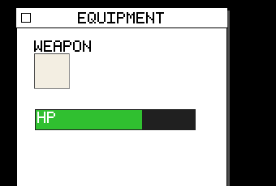

## Introduction

An [earlier article](../pascal-game-gui/) built a small retained-mode GUI
toolkit for FreePascal games, drawn in the System 7 and SimCity idiom: floating
windows over a live game canvas. Its whole bet was two abstraction seams. A
`TCanvas` hides the renderer, so the widget tree never names a drawing API. A
`TTheme` hides the chrome, so the widget tree never draws a border itself. The
claim was that those two seams are enough to keep the toolkit portable.

Since then, two projects put that claim under load. A dungeon RPG kept the core
almost byte for byte and swapped everything behind the seams: it replaced the
SDL2 canvas with a batched OpenGL overlay, replaced the 5x7 uppercase font with
a runtime-loadable proportional one, and pulled the theme into its own unit. A
second project ported the toolkit to C on SDL3, added a second theme styled
after the NES, and bolted on a keyboard and gamepad focus model. Between them the
seams survived a backend swap, a font swap, a theme swap, a language port, and a
new input model. Nothing in the core had to change for any of it.

That is the result this article collects on. If the seams are strong enough to
carry a backend swap and a language port, they are strong enough to become a
*language boundary*. This v2 keeps the authoritative toolkit in FreePascal,
compiles it to a shared library with a flat C ABI, and drives the same core,
unchanged, from four languages: Pascal natively, and C, Lua, and Python through
the ABI. The substance of the work is the boundary, not the widgets.


## Abstract

The toolkit's core stays in FreePascal and is compiled into `libgui.so` through
a single ABI unit that is the only code aware of the C calling convention. Every
object is named by an opaque 64-bit handle that carries a generation counter, so
a stale or forged handle fails cleanly instead of dereferencing freed memory.
Nothing managed crosses the line: strings pass as `PChar`, geometry as plain
integers, and no Pascal exception is allowed to unwind into the caller.

The shipped core is the universal set from v1: window, label, button, item slot,
item grid, tab bar, scroll view, and the drag-and-drop protocol, with a choice of
the System 7 or NES theme. Richer widgets like a paperdoll or a paged inventory
are not in the core. They are compositions built on top, and one is included as
an extension to show the foundation carries that weight without growing.

Four bindings exercise the one library. Pascal uses the core directly with no
FFI, because it is the home language. C includes the header and calls the handles
directly. Lua loads a small C module. Python loads the library with `ctypes` and
no build step at all. All four drive the same scene and pass the same headless
self-test: build an inventory, drag an item across windows, read the result back,
and confirm a destroyed handle can no longer be used.

## Why a C ABI, and Why the Core Stays Pascal

Whatever the languages, they meet at a C ABI: a flat set of functions, integers,
pointers, and null-terminated strings that every toolchain already knows how to
call. So the boundary is a C ABI no matter what. The only real question is which
language holds the implementation behind it.

Keeping the core in Pascal is the deliberate choice. This is a Pascal toolkit,
and its mature implementation already exists in Pascal, so the ABI exposes proven
code rather than a re-port. It also makes the more interesting article. A C
library with bindings is one of the most common shapes in software, and there's
little to discover in it. A *Pascal* library that C, Lua, and Python all drive is
unusual, and the question it forces, how to present FreePascal's classes, managed
strings, and exceptions as a flat C ABI without any of them leaking across the
boundary, is where the real engineering lives.

FreePascal compiles a `library` unit with an `exports` clause straight to a
`.so`, `.dll`, or `.dylib`. One rule makes it buildable as a shared object: every
unit must be compiled position-independent (`-Cg`), or the linker refuses the
baked-in font table. With that, the core, the themes, and the SDL canvas all link
into a single library behind the ABI.

## The Handle Table and the Flat Boundary

A C caller cannot hold a Pascal object reference. It holds a handle, and the
handle is the first real design decision.

The naive choice is to cast the object pointer to an integer and hand it back.
That works until a script keeps a handle one call too long. The object is freed,
the pointer dangles, and the next use corrupts memory. A GUI driven from Lua or
Python *will* hold a handle too long, because that's what scripts do. So the
handle is an index into a table plus a generation counter, never a raw pointer:

```pascal
function Encode(slot: LongInt; gen: LongWord): UInt64;
begin
  Encode := (UInt64(slot + 1) shl 32) or gen;
end;
```

The high 32 bits select a slot; the low 32 are the generation that slot carried
when the handle was minted. Freeing a slot bumps its generation, so every handle
that still names the old slot stops resolving. Resolution checks the bounds, the
kind, and the generation before it returns anything:

```pascal
function Resolve(h: UInt64; kind: THandleKind): TObject;
var slot: LongInt; gen: LongWord;
begin
  Resolve := nil;
  if h = 0 then exit;                        { 0 is the null handle }
  slot := LongInt(h shr 32) - 1;
  gen  := LongWord(h and $FFFFFFFF);
  if (slot < 0) or (slot > High(Handles)) then exit;
  if Handles[slot].Kind = hkFree then exit;
  if (kind <> hkFree) and (Handles[slot].Kind <> kind) then exit;
  if Handles[slot].Gen <> gen then exit;
  Resolve := Handles[slot].Obj;
end;
```

The retained-mode tree makes this tractable. The core never frees a widget in
the middle of dispatch. Closing a window hides it; it does not destroy it. The
only destruction is a desktop tearing down its whole tree. So when the ABI
destroys a desktop, it walks the table once and invalidates every handle that
belongs to that desktop's tree *before* the tree is freed. Nothing stale can
survive the destroy, and a call on an old handle afterward returns an error
rather than a crash. The self-tests check exactly that case.

The rest of the flat-boundary discipline is unglamorous and absolute. Strings go
in as `PChar` and come out through a caller buffer that reports the length it
needed. Rectangles and points are integer quadruples. And no Pascal exception may
cross into the caller, so every export wraps its body:

```pascal
function gui_window_set_title(win: UInt64; title: PChar): Int32; cdecl;
var w: TWidget;
begin
  gui_window_set_title := -1;
  try
    w := WidgetOf(win);
    if (w = nil) or not (w is TWindow) then exit;
    TWindow(w).Title := StrPas(title);
    gui_window_set_title := 0;
  except
    gui_window_set_title := -1;
  end;
end;
```

Handle-returning functions return 0 on failure; status functions return 0 on
success and a negative code on error. There's nothing clever here, and that's
the point. The boundary is boring so the code on either side can be simple.

## Events Without Subclassing

A desktop toolkit lets you subclass a widget and override its behavior. Across an
FFI edge that's a trap. Subclassing from Lua would mean the C core calling
back up into the Lua VM for every widget, every frame, with all the reentrancy
and lifetime questions that implies. So the ABI does not offer it. Foreign code
composes the built-in widgets and listens for a fixed set of events.

The core already reports what happens through Pascal method callbacks: a button's
`OnClick`, a tab bar's `OnChange`, the desktop's `OnDragEnd`. The ABI wires those
to its own handlers, which push a flat record onto a per-desktop queue. The caller
pulls from the queue when it likes:

```c
typedef struct {
    int32_t  kind;      /* GUI_EV_BUTTON, GUI_EV_TAB, GUI_EV_DROP, GUI_EV_POPUP */
    uint64_t widget;    /* the widget that fired it, 0 when not applicable */
    int32_t  i0;        /* button tag, tab index, or popup index */
    int32_t  i1;
} gui_event;

int32_t gui_poll_event(gui_handle d, gui_event *ev);  /* 1 if one was written */
```

The pull model is chosen deliberately over a registered callback. It marshals
trivially to `ctypes` and to Lua, it never reenters the VM at an awkward moment,
and it matches how a game already runs: pump input, poll events, update, draw.

One event deserves a note, because it shows the retained-mode grain. When an item
is dropped, the core reports the drop at the desktop level, not "item X landed in
slot Y." That is intentional. The slot tree already holds the truth of where
everything is. The drop event is a nudge that says "the layout changed, re-read
the slots you care about," and the owner does exactly that. The mature RPG that
seeded this design syncs its inventory model the same way.

## The One Escape Hatch

Composition covers most of a game's interface, but not all of it. Sooner or later
a game wants a widget the core has never heard of: a minimap, a portrait, a custom
gauge. For that there is one escape hatch, and only one. A custom widget takes a
foreign draw callback and hands it the canvas:

```c
typedef void (*gui_draw_fn)(void *canvas, int32_t l, int32_t t,
                            int32_t r, int32_t b, void *user);

gui_handle gui_custom_create(gui_handle parent, int32_t l, int32_t t,
                             int32_t w, int32_t h, gui_draw_fn draw, void *user);
```

The callback paints through the same canvas the whole toolkit uses, reached by a
handful of primitives (`gui_canvas_fill_rect`, `gui_canvas_text`, and a few
more). The canvas token it receives is the very `TCanvas` the core handed the
widget, so a foreign routine draws with exactly the capabilities a native widget
has, and no more. Here is a small HP gauge, written in C and drawn by Pascal:

```c
static void
gauge(void *cv, int32_t l, int32_t t, int32_t r, int32_t b, void *user)
{
    int mid = l + (r - l) * 2 / 3;
    gui_canvas_fill_rect(cv, l, t, r, b, 0xFF202020u);
    gui_canvas_fill_rect(cv, l + 2, t + 2, mid, b - 2, 0xFF30C030u);
    gui_canvas_frame_rect(cv, l, t, r, b, 0xFFFFFFFFu);
    gui_canvas_text(cv, l + 4, t + 4, "HP", 0xFFFFFFFFu);
}
```



This is the same `TCanvas` seam the v1 article designed, now reaching one level
further out. In v1 the seam let the toolkit target SDL or OpenGL. Here it lets a
function in another language paint a widget, through the identical interface. The
seam that made the toolkit portable is the seam that makes it extensible across
the boundary. It is the same seam.

## Four Bindings, One Scene

Each binding builds the same scene: an inventory window with a tabbed grid of
item tiles, and an equipment window with a slot and the custom gauge. The
differences between the bindings are the differences between the languages, not
differences in the toolkit.

**Pascal** does not use the ABI at all. It is the home language, so it uses the
core directly:

```pascal
uses gui, guitheme, richwidgets;
...
desk := TDesktop.Create(TSystem7Theme.Create, 760, 520);
invWin := TWindow.Create(desk, 'Inventory', [wfClose, wfDrag, wfZoom], 40, 40, 300, 280);
inv := TPagedInventory.Create(invWin.Content, 3, 4, 3, 0, 0);
```

**C** includes the header and calls the handles directly, with no marshalling
layer, because the ABI is already C:

```c
gui_handle d = gui_desktop_create(GUI_THEME_SYSTEM7, 760, 520);
gui_handle inv = gui_window_create(d, "Inventory",
                     GUI_WF_CLOSE | GUI_WF_DRAG | GUI_WF_ZOOM, 40, 40, 360, 260);
gui_handle grid = gui_grid_create(gui_window_content(inv), 4, 2, 0, 44, 12, 40);
```

**Python** needs no build step. A single `ctypes` file declares the ABI and the
library loads at import:

```python
import gui
d = gui.Desktop(theme=gui.THEME_SYSTEM7, w=760, h=520)
inv = d.window("Inventory", flags=gui.WF_CLOSE | gui.WF_DRAG, l=40, t=40, w=360, h=260)
grid = inv.content().grid(4, 2, pitch=44, l=12, t=40)
grid.slot_at(0, 0).set_item("Map", color=0xFF3366CC, glyph=ord("M"), tag=100)
```

**Lua** loads a small C module (`require 'gui'`) that wraps the same handles:

```lua
local gui = require("gui")
local d = gui.desktop_create(gui.THEME_SYSTEM7, 760, 520)
local inv = gui.window_create(d, "Inventory", gui.WF_CLOSE + gui.WF_DRAG, 40, 40, 360, 260)
local grid = gui.grid_create(gui.window_content(inv), 4, 2, 0, 44, 12, 40)
```

Every binding runs the same headless self-test. It builds the scene, finds a
filled slot and an empty one by their absolute rectangles, drags from one to the
other with synthetic mouse events, drains the event queue looking for the drop,
and then confirms the item's tag moved from the source slot to the destination.
Finally it destroys the desktop and calls once more on a now-stale handle, which
must fail cleanly. C, Lua, and Python all report the same three lines:

```
drop event delivered: true
item moved src->weapon (tag 101): true
stale handle rejected cleanly: true
```

A note on Python. The global policy for these projects is to avoid Python for
anything long-lived, because it will not be maintained. A binding is the deliberate
exception: it is a single `ctypes` file with no build step and no dependencies, and
it earns its place by showing that the ABI is honestly flat. If `ctypes` can drive
it, anything with an FFI can.

## Proof the Foundation Holds

The shipped core stops at the universal widgets. It does not include a paperdoll
or a paged inventory, and that restraint is the claim: those belong on top of the
core, not in it. To make the claim falsifiable, one such extension ships with the
demo, built only from core parts.

The paperdoll is a figure with five category-locked slots. Each slot is an
ordinary `TItemSlot` with an accept mask, so the head slot takes only helms and
the main hand takes only weapons. The paged inventory is a `TTabBar` over several
`TItemGrid` pages, switching which grid is visible as the tabs change. Neither
needed a single change to the core. The drag protocol the core already ships does
all the validation: a weapon dropped on the main hand is accepted, a helm dropped
on the main hand is refused and returns to where it came from, and the same helm
dropped on the head slot is accepted. The native self-test checks all three.

That is the test of a foundation. The hard examples turn out to be compositions,
and the core never had to know they were coming.

## Two Themes, Swapped at Run Time

The theme seam also survives to the ABI, and it swaps live. A desktop is created
with a theme id, `GUI_THEME_SYSTEM7` or `GUI_THEME_NES`, and `gui_desktop_set_theme`
replaces it at any time. The call builds the new theme, installs it, and frees the
one it replaced; the next frame repaints the whole tree through it. The animation
at the top of this article is exactly that swap: one scene, the identical widget
tree, the identical drag protocol, dissolving between the two themes. The only
difference from frame to frame is which `TTheme` the desktop is holding.

Every binding's demo binds the `T` key to the toggle, and the mechanism shows the
event design paying off: the SDL run loop puts a key-press on the same pull queue
as every other event, the host reads it, and the host decides it means "swap the
theme." The library hardcodes no key. Here it is in C:

```c
while (gui_poll_event(d, &ev) == 1)
    if (ev.kind == GUI_EV_KEY && (ev.i0 == 't' || ev.i0 == 'T')) {
        int cur = gui_desktop_theme(d);
        gui_desktop_set_theme(d, cur == GUI_THEME_NES ? GUI_THEME_SYSTEM7
                                                      : GUI_THEME_NES);
    }
```

The System 7 theme is the original white-window chrome; the NES theme, ported from
the C project's Mega Man styling, paints black panels with bright blue double
borders. Both draw only through `TCanvas`, so neither knows which renderer is
behind it, and neither knows which language asked for it. The native Pascal host
does the same swap without the ABI, calling `TDesktop.SetTheme` directly, which is
the one small addition v2 made to the core.

## What v2 Includes and Defers

In the ABI: the handle table, the universal widget set, drag-and-drop, the
pull-model event queue, the custom-draw escape hatch with its canvas primitives,
synthetic input for headless testing, a batteries-included SDL2 render loop, and
a headless BMP renderer. Two themes, swappable at run time. Four bindings.

Deferred on purpose. The toolkit ships the v1 bitmap font, uppercase and fixed
width, so it needs no font files; the proportional runtime-loadable font the RPG
built is a known next step, not a v2 requirement. The keyboard and gamepad focus
model from the C project is also deferred: it is additive and does not change the
boundary. Foreign code cannot yet define a wholly new widget *type*, only compose
built-ins and supply a custom-draw routine; that line is where the boundary stays
simple, and moving it is the one change that would make the ABI much larger.

## Running It

The toolkit and all four bindings are in `demo/`
([README](demo/README.md), [HTML](demo/README.html)). `make` builds the shared
library, the native Pascal demo, and the C and Lua bindings; the Python binding
needs no build step. `make check` runs the Pascal, Lua, and Python self-tests,
each of which drives the scene headless and checks the drag, the drop event, and
the stale-handle rejection. The only hard dependency is `libsdl2-dev`; the Lua
and Python modules are built or loaded only if their runtimes are present.

## Conclusion

The v1 article argued that a game GUI needs only two seams, a canvas and a theme,
to stay small and portable. Two real projects then proved the seams by swapping
the backend, the font, the theme, the language, and the input model without
touching the core. This v2 is what those seams were worth: turned ninety degrees,
the same two seams become a language boundary, and one Pascal core serves Pascal,
C, Lua, and Python at once.

The engineering that matters is not in the widgets, which were done in v1. It is
in the thirty millimeters of boundary: a handle that is an index and a generation
instead of a pointer, a rule that nothing managed and no exception may cross, an
event queue that is pulled rather than pushed, and exactly one escape hatch for
foreign drawing. Those four decisions are what let a toolkit written in one
language be driven honestly from four. The demo backs the claim the only way a
claim like this can be backed: the same scene, the same drag, the same self-test,
passing from C, from Lua, from Python, and natively from the Pascal it was written
in.
