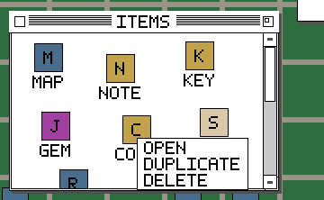

## Introduction

Open SimCity Classic on a Macintosh and look at what is on the screen. The whole
background is the city: a live, scrolling, tile-by-tile simulation that never
stops ticking. Floating on top of it are ordinary Macintosh windows. A budget
window, a map window, a graph window, an evaluation window. Each one is a real
System 7 window with a striped title bar, a close box in the top-left corner, and
a drag region. You move them around, you close the ones you do not need, and the
city keeps running underneath. The windowing system and the game are two separate
layers that share one screen.

That layering is the whole idea behind this article. A large class of games wants
exactly this arrangement: a full-screen background that *is* the game (a
first-person dungeon, a third-person RPG field, a city map, a tactical grid) with
discrete rectangular panels floating on top of it for inventory, character sheets,
dialogue, maps, and options. The background owns the world. The windows own the
interface.

Most GUI toolkits are the wrong shape for this. Desktop toolkits (the LCL, GTK,
Qt) assume *they* own the screen and your content lives inside their widgets. Game
UI libraries like Dear ImGui invert the problem the other way: they are immediate
mode, rebuilding the entire interface every frame, which suits debug overlays but
fights you the moment you want a draggable item that remembers where it was
dropped.

This article designs a third thing: a small **retained-mode** widget toolkit for
FreePascal, visually and behaviorally modeled on System 7, built specifically to
float windows over a game canvas. The goal is a genuine MVP. Small enough to read
in an afternoon, useful enough to ship a game with, and architected so that games
can bolt on the strange widgets they actually need. To prove the extension seam
works, we build two of those strange widgets: a multi-page inventory in the style
of *Neverwinter Nights*, and an equipment paperdoll in the style of *Ultima* and
*Dungeon Master*.

## What Is Actually Universal in Game GUIs

Before designing a core, it is worth asking what every game GUI actually contains.
Strip away the theme and the genre and a surprisingly short list of elements shows
up again and again. The useful distinction is between a *desktop* toolkit's idea
of "universal" and a *game* toolkit's idea of it. They overlap, but not completely.

A conventional desktop toolkit treats the button, the text field, the menu, and the
scrollbar as the irreducible core. A game toolkit keeps most of those, drops some
(games rarely need a real text-entry field), and promotes four elements that
desktop toolkits treat as exotic: the **gauge**, the **icon**, the **slot**, and
**drag-and-drop**. Those four are near-universal in games and nearly absent from
desktop toolkits, and that gap is exactly why reaching for GTK feels wrong.

The table below surveys the candidates. "Core" means it earns a place in the MVP.
"Extension" means it is better built on top of the core by the game that needs it.

| Element | Where it shows up | Verdict |
|---|---|---|
| **Window / panel** | Every menu, dialog, inventory, options screen | **Core** |
| **Label** (static text) | HUD numbers, descriptions, tooltips, titles | **Core** |
| **Button** (push to act) | The single most universal control in any UI | **Core** |
| **Icon / bitmap view** | Item art, portraits, map tiles, ability glyphs | **Core** |
| **Gauge / bar** | Health, mana, stamina, XP, loading, cast timers | **Core** |
| **Slot** (holds one item) | Inventory cells, equipment, hotbars, crafting | **Core** |
| **Drag-and-drop** | Moving items between slots, bags, the world | **Core** |
| **Scroll view + scrollbar** | Long lists, large maps, quest logs | **Core** |
| **List / grid** | Inventories, menus, save slots, dialogue options | **Core** |
| **Tooltip** | Hover-to-inspect, item stats | **Core** |
| **Menu bar / pull-down** | SimCity-style tool and view menus | **Core (thin)** |
| **Tabs / pages** | Switching bags, character-sheet sections | **Core (thin)** |
| **Modal dialog / alert** | Confirmations, "are you sure?", level-up | **Core** |
| **Checkbox / radio** | Options screens | Extension |
| **Text entry field** | Character naming, chat, search | Extension |
| **Tree view** | Skill trees, file browsers | Extension |
| **Paperdoll** | RPG equipment on a body figure | **Extension (worked example)** |
| **Radial / pie menu** | Action wheels, gesture menus | Extension |
| **Minimap widget** | Positional overview | Extension |

The core is deliberately short. Text entry is demoted to an extension because most
games need it in exactly one place (naming a character) and a full editable field
with a caret, selection, and clipboard is a disproportionate amount of code for
that. A game that needs chat can build it on the core. The same logic applies to
checkboxes and trees: real, but not load-bearing.

What the core *must* get right is the quartet that desktop toolkits neglect. A
game's interface lives or dies on how items move: picking an item up from a bag,
dragging it across a paperdoll, dropping it on the right slot, and having it snap
into place and stay there. That behavior is the reason this toolkit is retained
mode, and it is the reason slots and drag-and-drop are in the core rather than
left to each game to reinvent.

## Retained Mode, and Why

A GUI toolkit has to decide where the state of the interface lives. There are two
answers, and the choice colors everything else.

In **immediate mode** (Dear ImGui, egui, Unity's old IMGUI) there are no widget
objects. Every frame, the application calls functions like `Button("OK")` and the
library draws the button and returns whether it was clicked, all in one call. The
widget hierarchy is implied by the order of the calls, and nothing persists
between frames. This is wonderful for tools and debug overlays, where the UI
mirrors live program state and you would rather not keep a second copy of that
state in widget objects.

In **retained mode** (every desktop toolkit, and this one) the widgets are
long-lived objects in a tree. You create a window once, it holds its children, and
it stays there until you destroy it. Input arrives as events that the toolkit
routes down the tree to the right widget. The toolkit owns hit-testing, focus,
z-order, and redraw.

For a game that floats persistent windows over a world, retained mode is the
natural fit, for three concrete reasons:

1. **State lives in the widgets, which is where a game wants it.** An item dropped
   into an equipment slot should *stay* there across frames without the game
   re-issuing the whole UI every tick. The slot remembers its contents. That is a
   retained-mode idea.

2. **Hit-testing and z-order are real problems here.** When windows overlap and
   the city scrolls behind them, you need correct answers to "what did the mouse
   click?" and "which window is on top?". Immediate-mode toolkits are known to
   handle occlusion, focus, and overlapping windows poorly, because the tree that
   would answer those questions does not exist. Retained mode keeps the tree, so
   the answers are a walk.

3. **Drag-and-drop wants persistent sources and targets.** A drag begins on one
   widget and ends on another, possibly in a different window, with a drag image
   following the cursor in between. Modeling that as events delivered to
   long-lived source and target objects is straightforward. Modeling it in
   immediate mode means threading drag state through global variables by hand.

The cost of retained mode is that you maintain a tree of objects and a redraw
story. For a game that already runs a render loop, that cost is small: the game
owns the frame, draws its world, then asks the toolkit to paint the windows on
top. There is no fighting over who owns the screen.

## Core Architecture

The toolkit is built from a handful of pieces: a drawing seam, a widget tree, an
event model, a desktop root that holds the game as its background, the window, and
a theme object that draws the System 7 chrome. Everything else is a subclass of
the base widget.

The code targets modern FreePascal (`{$mode objfpc}{$H+}`) and uses real classes
with virtual methods, because a retained-mode widget tree is the textbook use for
them. Naming follows the usual Pascal conventions: `T`-prefixed PascalCase types,
PascalCase methods, camelCase locals and fields.

### The Drawing Seam

The toolkit never talks to a specific graphics API. It draws through an abstract
`TCanvas` whose concrete subclass a game supplies, wrapping SDL2, a software
framebuffer, OpenGL, or anything else. This is the first and most important
extension point: the toolkit is backend-agnostic by construction.

```pascal
type
  TColor = Longword;        { 0xAARRGGBB, or a palette index for 1-bit themes }

  TCanvas = class
  public
    procedure SetClip(const r: TRect); virtual; abstract;
    procedure FillRect(const r: TRect; c: TColor); virtual; abstract;
    procedure FrameRect(const r: TRect; c: TColor); virtual; abstract;
    procedure HLine(x1, x2, y: LongInt; c: TColor); virtual; abstract;
    procedure VLine(x, y1, y2: LongInt; c: TColor); virtual; abstract;
    procedure DrawText(x, y: LongInt; const s: string; c: TColor); virtual; abstract;
    function  TextWidth(const s: string): LongInt; virtual; abstract;
    procedure DrawBitmap(x, y: LongInt; bmp: TBitmap); virtual; abstract;
  end;
```

That is the entire surface the toolkit needs. A rectangle, a frame, two kinds of
line, text with measurement, and a blit. Everything the System 7 theme draws
(striped title bars, chamfered buttons, framed slots) is built from these seven
calls. Porting the toolkit to a new backend means implementing one class.

### Geometry and Events

Two small value types carry coordinates, and one carries input. Events are mutable
records passed by reference so a handler can mark one consumed.

```pascal
type
  TPoint = record X, Y: LongInt; end;
  TRect  = record Left, Top, Right, Bottom: LongInt; end;

  TEventKind = (ekMouseDown, ekMouseUp, ekMouseMove, ekMouseWheel,
                ekKeyDown, ekKeyUp);

  TUIEvent = record
    Kind:    TEventKind;
    Pos:     TPoint;      { mouse position in root (screen) coordinates }
    Button:  LongInt;     { 0 = left, 1 = right, 2 = middle }
    Key:     LongInt;     { virtual key code, for key events }
    Wheel:   LongInt;     { signed wheel delta }
    Handled: Boolean;     { a handler sets this to stop propagation }
  end;
```

### The Widget Tree

`TWidget` is the base of everything. It holds its bounds in parent coordinates, a
list of children, and the override points that subclasses use to draw and respond.
The default `Draw` paints children back-to-front; the default `HitTest` walks
children front-to-back and returns the topmost hit.

```pascal
type
  TDragItem = class;   { forward; defined with drag-and-drop below }

  TWidget = class
  protected
    FParent:   TWidget;
    FChildren: TFPList;        { of TWidget, back-to-front z-order }
    FBounds:   TRect;          { in parent coordinates }
    FVisible:  Boolean;
    FEnabled:  Boolean;
  public
    constructor Create(AParent: TWidget);
    destructor  Destroy; override;

    { ---- tree ---- }
    procedure AddChild(w: TWidget);
    function  RootToLocal(const p: TPoint): TPoint;
    function  LocalToRoot(const p: TPoint): TPoint;
    function  HitTest(const p: TPoint): TWidget; virtual;   { p in root coords }

    { ---- drawing (override point) ---- }
    procedure Draw(cv: TCanvas); virtual;       { default: paint children }

    { ---- input (override points, default no-ops) ---- }
    procedure OnMouseDown(var e: TUIEvent); virtual;
    procedure OnMouseUp(var e: TUIEvent); virtual;
    procedure OnMouseMove(var e: TUIEvent); virtual;
    procedure OnKeyDown(var e: TUIEvent); virtual;

    { ---- drag-and-drop capability (default: not a source or target) ---- }
    function  DragStart(const p: TPoint): TDragItem; virtual;   { nil = not a source }
    function  DragAccepts(it: TDragItem): Boolean; virtual;     { false = not a target }
    procedure DragDrop(it: TDragItem; const p: TPoint); virtual;

    property Bounds:  TRect   read FBounds  write SetBounds;
    property Visible: Boolean read FVisible write FVisible;
    property Enabled: Boolean read FEnabled write FEnabled;
    property Parent:  TWidget read FParent;
  end;
```

Two design choices in that interface are worth calling out.

First, **drag-and-drop is a capability expressed as three virtual methods on the
base class, not a separate interface hierarchy.** A widget that is a drag source
overrides `DragStart` to return a payload. A widget that is a drop target
overrides `DragAccepts` and `DragDrop`. Everything else inherits the no-op
defaults and plays no part in dragging. This avoids FPC's interface-and-refcount
machinery entirely and keeps the whole toolkit as a plain class tree. A minimal
library should not make you reason about `IUnknown` lifetime to move an item
between two bags.

Second, **there are no getters and setters in the public surface for the common
case.** `Bounds`, `Visible`, and `Enabled` are properties so that setting them can
trigger a redraw, but the override points a game cares about are plain virtual
methods. The extension story is "subclass and override," which is the thing Object
Pascal does best.

### The Desktop Root and the Game Background

The root of the tree is the `TDesktop`. It is special in one way: its background is
the live game. Everything the toolkit draws is painted *over* a canvas that the
game has already filled with its world. The desktop also owns the three pieces of
global interface state that cannot belong to any single window: keyboard focus, the
active (front) window, and the in-progress drag session.

```pascal
type
  TDesktop = class(TWidget)
  private
    FFocus:    TWidget;         { current keyboard focus }
    FActive:   TWindow;         { front-most window }
    FDrag:     TDragSession;    { nil when nothing is being dragged }
    FMenuBar:  TMenuBar;        { optional, SimCity-style top menu }
    FTheme:    TTheme;
  public
    procedure Dispatch(var e: TUIEvent);  { host feeds raw input here }
    procedure Paint(cv: TCanvas);         { paint windows over the game }
    procedure BringToFront(w: TWindow);
    property  Theme: TTheme read FTheme write FTheme;
  end;
```

The host game loop is then a clean handshake. The game draws the world, the desktop
draws the windows, and raw input is forwarded in:

```pascal
{ ---- per frame ---- }
Game.RenderWorld(cv);        { background: the first-person view, the city map... }
Desktop.Paint(cv);           { windows, drag image, and cursor on top }

{ ---- per input event ---- }
Desktop.Dispatch(ev);        { toolkit routes it to the right widget }
```

`Dispatch` is where retained mode earns its keep. A mouse-down is hit-tested from
the front window backward; the hit sets the active window and keyboard focus, then
the event bubbles from the deepest hit widget up through its parents until one
marks it handled. A mouse-down in empty space (a hit on the desktop itself) falls
through to the game, so clicking the city behind the windows still places a road. A
drag in progress short-circuits all of this and routes to the drag session
instead.

### Class Hierarchy

The whole toolkit is a shallow tree of subclasses. The core is the unshaded
nodes; the worked extensions are shaded.

<svg viewBox="0 0 720 300" xmlns="http://www.w3.org/2000/svg" font-family="IBM Plex Mono, monospace" font-size="13" style="max-width:100%;height:auto;background:#fff">
  <style>
    .box{fill:#fff;stroke:#2c2420;stroke-width:1.5}
    .ext{fill:#efe7d6;stroke:#2c2420;stroke-width:1.5}
    .t{fill:#2c2420}
    .ln{stroke:#2c2420;stroke-width:1}
  </style>
  <!-- root -->
  <rect class="box" x="300" y="12" width="120" height="30"/>
  <text class="t" x="360" y="31" text-anchor="middle">TWidget</text>
  <!-- level 2 -->
  <line class="ln" x1="360" y1="42" x2="360" y2="70"/>
  <line class="ln" x1="80" y1="70" x2="660" y2="70"/>
  <g>
    <line class="ln" x1="80"  y1="70" x2="80"  y2="92"/>
    <line class="ln" x1="200" y1="70" x2="200" y2="92"/>
    <line class="ln" x1="330" y1="70" x2="330" y2="92"/>
    <line class="ln" x1="450" y1="70" x2="450" y2="92"/>
    <line class="ln" x1="560" y1="70" x2="560" y2="92"/>
    <line class="ln" x1="660" y1="70" x2="660" y2="92"/>
  </g>
  <rect class="box" x="24"  y="92" width="112" height="28"/>
  <text class="t" x="80"  y="110" text-anchor="middle">TDesktop</text>
  <rect class="box" x="150" y="92" width="100" height="28"/>
  <text class="t" x="200" y="110" text-anchor="middle">TWindow</text>
  <rect class="box" x="280" y="92" width="100" height="28"/>
  <text class="t" x="330" y="110" text-anchor="middle">TButton</text>
  <rect class="box" x="400" y="92" width="100" height="28"/>
  <text class="t" x="450" y="110" text-anchor="middle">TLabel</text>
  <rect class="box" x="512" y="92" width="96" height="28"/>
  <text class="t" x="560" y="110" text-anchor="middle">TGauge</text>
  <rect class="box" x="616" y="92" width="92" height="28"/>
  <text class="t" x="662" y="110" text-anchor="middle">TIcon</text>
  <!-- second row of core -->
  <rect class="box" x="150" y="150" width="100" height="28"/>
  <text class="t" x="200" y="168" text-anchor="middle">TScrollView</text>
  <rect class="box" x="280" y="150" width="100" height="28"/>
  <text class="t" x="330" y="168" text-anchor="middle">TItemSlot</text>
  <rect class="box" x="400" y="150" width="100" height="28"/>
  <text class="t" x="450" y="168" text-anchor="middle">TItemGrid</text>
  <rect class="box" x="512" y="150" width="96" height="28"/>
  <text class="t" x="560" y="168" text-anchor="middle">TTabBar</text>
  <rect class="box" x="616" y="150" width="96" height="28"/>
  <text class="t" x="664" y="168" text-anchor="middle">TPopupMenu</text>
  <line class="ln" x1="360" y1="124" x2="360" y2="140"/>
  <line class="ln" x1="200" y1="140" x2="664" y2="140"/>
  <line class="ln" x1="200" y1="140" x2="200" y2="150"/>
  <line class="ln" x1="330" y1="140" x2="330" y2="150"/>
  <line class="ln" x1="450" y1="140" x2="450" y2="150"/>
  <line class="ln" x1="560" y1="140" x2="560" y2="150"/>
  <line class="ln" x1="664" y1="140" x2="664" y2="150"/>
  <!-- extensions -->
  <line class="ln" x1="390" y1="178" x2="390" y2="200"/>
  <line class="ln" x1="140" y1="200" x2="585" y2="200"/>
  <line class="ln" x1="140" y1="200" x2="140" y2="238"/>
  <line class="ln" x1="360" y1="200" x2="360" y2="238"/>
  <line class="ln" x1="585" y1="200" x2="585" y2="238"/>
  <rect class="ext" x="70"  y="238" width="140" height="30"/>
  <text class="t" x="140" y="257" text-anchor="middle">TInventoryWindow</text>
  <rect class="ext" x="300" y="238" width="120" height="30"/>
  <text class="t" x="360" y="257" text-anchor="middle">TPaperdoll</text>
  <rect class="ext" x="520" y="238" width="130" height="30"/>
  <text class="t" x="585" y="257" text-anchor="middle">TIconView</text>
  <text class="t" x="140" y="288" text-anchor="middle" font-size="11" fill="#766">tabs + item grids</text>
  <text class="t" x="360" y="288" text-anchor="middle" font-size="11" fill="#766">category-locked slots</text>
  <text class="t" x="585" y="288" text-anchor="middle" font-size="11" fill="#766">scroll view + popup menu</text>
</svg>

## The MVP Widget Set and the System 7 Look

The core widgets are thin. Most are a few dozen lines because they delegate their
actual appearance to a `TTheme` object. That indirection is the third extension
point (after the canvas and subclassing): the look of every window, button, and
slot is swappable without touching widget logic.

```pascal
type
  TTheme = class
  public
    procedure DrawWindowFrame(cv: TCanvas; w: TWindow); virtual; abstract;
    procedure DrawButton(cv: TCanvas; const r: TRect; const caption: string;
                         pressed, isDefault, enabled: Boolean); virtual; abstract;
    procedure DrawSlot(cv: TCanvas; const r: TRect; hot, filled: Boolean); virtual; abstract;
    procedure DrawGauge(cv: TCanvas; const r: TRect; frac: Single); virtual; abstract;
    function  TitleBarHeight: LongInt; virtual; abstract;
  end;
```

The default theme, `TSystem7Theme`, draws the look everyone recognizes from an
early-1990s Macintosh. A window is a white rectangle with a one-pixel black frame
and a one-pixel drop shadow. The title bar carries six horizontal racing stripes
when the window is active and is blank when it is not, so the front window is
obvious at a glance. A square close box sits at the left of the title bar and a
zoom box at the right. Push buttons are rounded rectangles with a black outline,
and the default button wears a heavier outer ring. Everything is drawn in a small
palette of black, white, and a couple of grays, which also means the toolkit runs
fine on a 1-bit or paletted framebuffer.

The anatomy of a window, with the names the toolkit uses:

<svg viewBox="0 0 560 300" xmlns="http://www.w3.org/2000/svg" font-family="IBM Plex Sans, sans-serif" font-size="12" style="max-width:100%;height:auto;background:#cfc6b4">
  <!-- drop shadow -->
  <rect x="64" y="34" width="420" height="246" fill="#000" opacity="0.25"/>
  <!-- window body -->
  <rect x="60" y="30" width="420" height="246" fill="#fff" stroke="#000" stroke-width="1.5"/>
  <!-- title bar -->
  <rect x="60" y="30" width="420" height="22" fill="#fff" stroke="#000" stroke-width="1.5"/>
  <!-- racing stripes (active) -->
  <g stroke="#000" stroke-width="1">
    <line x1="92" y1="35" x2="300" y2="35"/>
    <line x1="92" y1="38" x2="300" y2="38"/>
    <line x1="92" y1="41" x2="300" y2="41"/>
    <line x1="92" y1="44" x2="300" y2="44"/>
    <line x1="92" y1="47" x2="300" y2="47"/>
  </g>
  <!-- title text knockout -->
  <rect x="168" y="33" width="104" height="16" fill="#fff"/>
  <text x="220" y="45" text-anchor="middle" font-weight="bold" font-size="12">Inventory</text>
  <!-- close box -->
  <rect x="68" y="35" width="12" height="12" fill="#fff" stroke="#000"/>
  <!-- zoom box -->
  <rect x="460" y="35" width="12" height="12" fill="#fff" stroke="#000"/>
  <rect x="462" y="37" width="8" height="4" fill="none" stroke="#000" stroke-width="0.8"/>
  <!-- content -->
  <text x="270" y="150" text-anchor="middle" fill="#888" font-size="13">content area (a child widget)</text>
  <!-- grow box -->
  <rect x="464" y="256" width="16" height="16" fill="#fff" stroke="#000"/>
  <path d="M467 269 l10 -10 M471 269 l6 -6" stroke="#000" stroke-width="0.8" fill="none"/>
  <!-- labels / callouts -->
  <g font-size="11" fill="#2c2420">
    <text x="30" y="43" text-anchor="end">close box</text>
    <line x1="34" y1="40" x2="67" y2="40" stroke="#2c2420" stroke-width="0.8"/>
    <text x="30" y="60" text-anchor="end">title bar</text>
    <line x1="34" y1="57" x2="118" y2="47" stroke="#2c2420" stroke-width="0.8"/>
    <text x="520" y="43" text-anchor="start">zoom box</text>
    <line x1="516" y1="40" x2="473" y2="40" stroke="#2c2420" stroke-width="0.8"/>
    <text x="520" y="266" text-anchor="start">grow box</text>
    <line x1="516" y1="263" x2="481" y2="263" stroke="#2c2420" stroke-width="0.8"/>
  </g>
</svg>

`TWindow` holds a single content child that fills the area below the title bar. It
knows how to compute its own regions (title bar, close box, zoom box, grow box,
content) so that `Dispatch` can route a click on the close box to a close, a drag
on the title bar to a move, and everything else into the content child.

```pascal
type
  TWindowFlag  = (wfClose, wfZoom, wfGrow, wfDrag, wfVScroll, wfHScroll);
  TWindowFlags = set of TWindowFlag;

  TWindow = class(TWidget)
  private
    FTitle:   string;
    FFlags:   TWindowFlags;
    FContent: TWidget;         { fills the area under the title bar }
    FActive:  Boolean;
  public
    constructor Create(AParent: TWidget; const ATitle: string; AFlags: TWindowFlags);
    procedure Draw(cv: TCanvas); override;   { delegates chrome to the theme }
    function  TitleBarRect: TRect;
    function  CloseBoxRect: TRect;
    function  ContentRect:  TRect;
    property  Content: TWidget read FContent;
    property  Active:  Boolean read FActive;
  end;
```

The other core widgets follow the same pattern and are short enough to list by
role rather than in full: `TLabel` (one line of theme-drawn text), `TButton` (a
theme-drawn button that fires an `OnClick`), `TIcon` (a blitted bitmap, the
foundation of every item and portrait), `TGauge` (a fractional bar for health and
the like), `TScrollView` (a clipped viewport over an oversized child, with
scrollbars synthesized from the window flags), `TTabBar` (a row of tabs that fires
`OnChange`), and the two that make games tick: `TItemSlot` and `TItemGrid`.

## Drag-and-Drop and Slots: the Game Core

The slot is where the toolkit stops looking like a desktop and starts looking like
a game. A `TItemSlot` is a drop target that holds exactly one item, and a drag
source for the item it holds. An item is a small payload the game defines: a
category used for drop validation, an opaque handle back into game data, and an
icon to draw and to drag.

```pascal
type
  TDragItem = class
    Category: LongInt;    { game-defined: weapon, armor, potion, key... }
    Handle:   Pointer;    { game-defined: index or pointer into item data }
    Icon:     TBitmap;    { drawn in the slot and under the cursor while dragging }
  end;

  TItemSlot = class(TWidget)
  private
    FItem:    TDragItem;
    FAccepts: LongInt;    { bitmask of categories; 0 = accept anything }
  public
    constructor Create(AParent: TWidget; acceptMask: LongInt);
    procedure Draw(cv: TCanvas); override;

    { ---- drag source: picking the item up ---- }
    function  DragStart(const p: TPoint): TDragItem; override;
    { ---- drop target: putting an item down ---- }
    function  DragAccepts(it: TDragItem): Boolean; override;
    procedure DragDrop(it: TDragItem; const p: TPoint); override;

    property  Item: TDragItem read FItem write SetItem;
  end;
```

The three overrides are the whole protocol. `DragStart` hands the held item to the
drag session and clears the slot. `DragAccepts` checks the dragged item's category
against the slot's accept mask, which is how a helmet is refused by a boot slot.
`DragDrop` stores the item and triggers a redraw.

```pascal
function TItemSlot.DragStart(const p: TPoint): TDragItem;
begin
  if FItem = nil then
    Result := nil                 { empty slot is not a drag source }
  else begin
    Result := FItem;
    FItem := nil;                 { the item is now "in hand" }
    Invalidate;
  end;
end;

function TItemSlot.DragAccepts(it: TDragItem): Boolean;
begin
  Result := (FAccepts = 0) or ((FAccepts and it.Category) <> 0);
end;

procedure TItemSlot.DragDrop(it: TDragItem; const p: TPoint);
begin
  FItem := it;
  Invalidate;
end;
```

The desktop drives the drag itself. On a mouse-down the hit widget's `DragStart` is
called; if it returns an item, a `TDragSession` is born holding the item and the
cursor offset. On mouse-move the session is redrawn with the item's icon following
the cursor. On mouse-up the desktop hit-tests the drop location, walks up from the
hit widget to the first ancestor whose `DragAccepts` returns true, and calls its
`DragDrop`. If nothing accepts the item, the session returns it to the source slot,
so a fumbled drop is never a lost item. That return-to-source rule is a small
thing that separates a toolkit you can ship from one you cannot.

A `TItemGrid` is then almost nothing: a rectangular array of `TItemSlot` children,
laid out on a fixed pitch, all sharing one accept mask. It is the substrate for the
first extension.

## Extension One: a Multi-Page Inventory

*Neverwinter Nights* solved the "I have too many items" problem the way many RPGs
do: it gave the character several pages of inventory, switched by tabs, plus
containers (bags) that open their own pages. The player drags items between grids,
between pages, and in and out of bags, and everything of a given shape has a cell
to live in. Rebuilding that on the core is a matter of composition, not new
mechanism.

A `TInventoryWindow` is a `TWindow` whose content is a `TTabBar` over an array of
`TItemGrid` pages. Switching tabs shows a different grid. Because every grid is
made of the same `TItemSlot` the core already defines, drag-and-drop between pages
works with no extra code: the slots are the sources and the targets, the desktop
runs the session, and the tabs are just deciding which grid is visible.

```pascal
type
  TInventoryWindow = class(TWindow)
  private
    FTabs:  TTabBar;
    FPages: array of TItemGrid;
    procedure HandleTabChange(index: LongInt);
  public
    constructor Create(AParent: TWidget; pageCount, cols, rows, accept: LongInt);
    procedure ShowPage(i: LongInt);
    function  Page(i: LongInt): TItemGrid;
  end;

constructor TInventoryWindow.Create(AParent: TWidget;
  pageCount, cols, rows, accept: LongInt);
var
  i: LongInt;
begin
  inherited Create(AParent, 'Inventory', [wfClose, wfDrag, wfZoom]);
  FTabs := TTabBar.Create(Content);
  FTabs.OnChange := @HandleTabChange;
  SetLength(FPages, pageCount);
  for i := 0 to pageCount - 1 do begin
    FTabs.AddTab('Bag ' + IntToStr(i + 1));
    FPages[i] := TItemGrid.Create(Content, cols, rows, accept);
    FPages[i].Visible := (i = 0);        { only the first page shows at first }
  end;
end;

procedure TInventoryWindow.ShowPage(i: LongInt);
var
  k: LongInt;
begin
  for k := 0 to High(FPages) do
    FPages[k].Visible := (k = i);
  Invalidate;
end;
```

That is the entire extension. A page count, a grid shape, a shared accept mask, and
a tab handler that flips visibility. The multi-page inventory is less than a screen
of code because the hard parts (slots, dragging, hit-testing, return-to-source) all
live in the core and are simply reused.

<svg viewBox="0 0 520 300" xmlns="http://www.w3.org/2000/svg" font-family="IBM Plex Sans, sans-serif" font-size="12" style="max-width:100%;height:auto;background:#cfc6b4">
  <rect x="44" y="30" width="430" height="250" fill="#fff" stroke="#000" stroke-width="1.5"/>
  <rect x="44" y="30" width="430" height="22" fill="#fff" stroke="#000" stroke-width="1.5"/>
  <g stroke="#000" stroke-width="1">
    <line x1="76" y1="35" x2="180" y2="35"/><line x1="76" y1="38" x2="180" y2="38"/>
    <line x1="76" y1="41" x2="180" y2="41"/><line x1="76" y1="44" x2="180" y2="44"/>
    <line x1="76" y1="47" x2="180" y2="47"/>
  </g>
  <rect x="52" y="35" width="12" height="12" fill="#fff" stroke="#000"/>
  <rect x="200" y="33" width="80" height="16" fill="#fff"/>
  <text x="240" y="45" text-anchor="middle" font-weight="bold">Inventory</text>
  <!-- tabs -->
  <g>
    <rect x="52" y="58" width="60" height="20" fill="#fff" stroke="#000"/>
    <text x="82" y="72" text-anchor="middle" font-size="11">Bag 1</text>
    <rect x="114" y="58" width="60" height="20" fill="#e8e0cf" stroke="#000"/>
    <text x="144" y="72" text-anchor="middle" font-size="11">Bag 2</text>
    <rect x="176" y="58" width="60" height="20" fill="#e8e0cf" stroke="#000"/>
    <text x="206" y="72" text-anchor="middle" font-size="11">Bag 3</text>
    <rect x="238" y="58" width="60" height="20" fill="#e8e0cf" stroke="#000"/>
    <text x="268" y="72" text-anchor="middle" font-size="11">Bag 4</text>
  </g>
  <!-- grid of slots -->
  <g>
    <!-- draw 6x4 slots -->
    <!-- row generator omitted; explicit for clarity -->
    <g stroke="#000" fill="#f3eee2">
      <rect x="56" y="88" width="34" height="34"/><rect x="94" y="88" width="34" height="34"/>
      <rect x="132" y="88" width="34" height="34"/><rect x="170" y="88" width="34" height="34"/>
      <rect x="208" y="88" width="34" height="34"/><rect x="246" y="88" width="34" height="34"/>
      <rect x="56" y="126" width="34" height="34"/><rect x="94" y="126" width="34" height="34"/>
      <rect x="132" y="126" width="34" height="34"/><rect x="170" y="126" width="34" height="34"/>
      <rect x="208" y="126" width="34" height="34"/><rect x="246" y="126" width="34" height="34"/>
      <rect x="56" y="164" width="34" height="34"/><rect x="94" y="164" width="34" height="34"/>
      <rect x="132" y="164" width="34" height="34"/><rect x="170" y="164" width="34" height="34"/>
      <rect x="208" y="164" width="34" height="34"/><rect x="246" y="164" width="34" height="34"/>
      <rect x="56" y="202" width="34" height="34"/><rect x="94" y="202" width="34" height="34"/>
      <rect x="132" y="202" width="34" height="34"/><rect x="170" y="202" width="34" height="34"/>
      <rect x="208" y="202" width="34" height="34"/><rect x="246" y="202" width="34" height="34"/>
    </g>
    <!-- a couple of filled slots -->
    <circle cx="73" cy="105" r="11" fill="#9a6b3f" stroke="#000"/>
    <rect x="99" y="131" width="24" height="24" fill="#6b7f9a" stroke="#000"/>
    <path d="M149 168 l16 26 h-16 z" fill="#b5483a" stroke="#000"/>
  </g>
  <!-- drag image following cursor -->
  <rect x="330" y="150" width="34" height="34" fill="#f3eee2" stroke="#000" opacity="0.5"/>
  <circle cx="347" cy="167" r="11" fill="#9a6b3f" stroke="#000" opacity="0.8"/>
  <path d="M360 182 l0 16 l12 -6 z" fill="#000"/>
  <text x="300" y="266" font-size="11" fill="#2c2420">dragging an item between slots</text>
  <!-- weight / gold footer -->
  <text x="300" y="100" font-size="11" fill="#444">tabs switch</text>
  <text x="300" y="116" font-size="11" fill="#444">which grid</text>
  <text x="300" y="132" font-size="11" fill="#444">is visible</text>
</svg>

## Extension Two: the Equipment Paperdoll

If the inventory grid is a warehouse, the paperdoll is a wardrobe. The paperdoll
interface, pioneered by *Ultima VI* and refined through *Ultima VII*, *Dungeon
Master*, and *Ultima Underworld*, draws the character as a figure and places
equipment slots at the anatomically right spots: a helmet slot at the head, a boot
slot at the feet, a weapon in the hand. You equip by dragging an item from the
inventory onto the matching part of the body, and the figure updates to show it
worn. It is a large interface, because it has to show the whole character, and it
is the most recognizable UI convention in the whole CRPG tradition.

On this toolkit the paperdoll is a single widget whose children are category-locked
slots positioned over a figure bitmap. It needs no new mechanism at all, only the
accept-mask that `TItemSlot` already enforces. A head slot is created with an
accept mask of "helmet," so the core's `DragAccepts` refuses anything else. The
figure is just a bitmap drawn behind the slots.

```pascal
type
  { body locations, each a category-locked slot }
  TBodySlot = (bsHead, bsNeck, bsCloak, bsChest, bsArms, bsHands,
               bsRingL, bsRingR, bsWaist, bsLegs, bsFeet,
               bsMainHand, bsOffHand);

  TPaperdoll = class(TWidget)
  private
    FFigure: TBitmap;
    FSlots:  array[TBodySlot] of TItemSlot;
  public
    constructor Create(AParent: TWidget; figure: TBitmap);
    procedure Draw(cv: TCanvas); override;        { figure first, slots on top }
    procedure PlaceSlot(s: TBodySlot; const at: TRect; accept: LongInt);
    property  Slot[s: TBodySlot]: TItemSlot read GetSlot;
  end;

procedure TPaperdoll.PlaceSlot(s: TBodySlot; const at: TRect; accept: LongInt);
begin
  FSlots[s] := TItemSlot.Create(Self, accept);
  FSlots[s].Bounds := at;
end;

procedure TPaperdoll.Draw(cv: TCanvas);
begin
  cv.DrawBitmap(LocalToRoot(Point(0, 0)).X, LocalToRoot(Point(0, 0)).Y, FFigure);
  inherited Draw(cv);          { the slots paint over the figure }
end;
```

Wiring a classic layout is then a short table of placements. The categories
(`CAT_HELMET`, `CAT_WEAPON`, and so on) are the game's own constants, used as the
single bit each slot accepts:

```pascal
doll := TPaperdoll.Create(win.Content, HeroFigureBmp);
doll.PlaceSlot(bsHead,     Rect( 70,  8, 110, 48), CAT_HELMET);
doll.PlaceSlot(bsNeck,     Rect(118, 40, 150, 72), CAT_AMULET);
doll.PlaceSlot(bsChest,    Rect( 70, 56, 110, 96), CAT_ARMOR);
doll.PlaceSlot(bsMainHand, Rect( 20, 70,  60, 110), CAT_WEAPON);
doll.PlaceSlot(bsOffHand,  Rect(120, 70, 160, 110), CAT_SHIELD or CAT_WEAPON);
doll.PlaceSlot(bsHands,    Rect( 20, 40,  52,  72), CAT_GLOVES);
doll.PlaceSlot(bsLegs,     Rect( 70,104, 110, 144), CAT_LEGS);
doll.PlaceSlot(bsFeet,     Rect( 70,152, 110, 192), CAT_BOOTS);
```

The visual is the thing players remember: body slots arranged around a figure,
each accepting only what belongs there.

<svg viewBox="0 0 520 320" xmlns="http://www.w3.org/2000/svg" font-family="IBM Plex Sans, sans-serif" font-size="11" style="max-width:100%;height:auto;background:#cfc6b4">
  <rect x="150" y="20" width="220" height="286" fill="#fff" stroke="#000" stroke-width="1.5"/>
  <rect x="150" y="20" width="220" height="20" fill="#fff" stroke="#000" stroke-width="1.5"/>
  <g stroke="#000" stroke-width="1">
    <line x1="180" y1="25" x2="250" y2="25"/><line x1="180" y1="28" x2="250" y2="28"/>
    <line x1="180" y1="31" x2="250" y2="31"/><line x1="180" y1="34" x2="250" y2="34"/>
  </g>
  <rect x="156" y="24" width="12" height="12" fill="#fff" stroke="#000"/>
  <rect x="236" y="23" width="56" height="14" fill="#fff"/>
  <text x="264" y="34" text-anchor="middle" font-weight="bold" font-size="11">Equip</text>
  <!-- figure -->
  <g fill="#d9c9a8" stroke="#8a764f">
    <circle cx="260" cy="90" r="20"/>                 <!-- head -->
    <rect x="240" y="112" width="40" height="56" rx="6"/>  <!-- torso -->
    <rect x="224" y="116" width="14" height="48" rx="5"/>  <!-- left arm -->
    <rect x="282" y="116" width="14" height="48" rx="5"/>  <!-- right arm -->
    <rect x="244" y="170" width="14" height="56" rx="5"/>  <!-- left leg -->
    <rect x="262" y="170" width="14" height="56" rx="5"/>  <!-- right leg -->
  </g>
  <!-- slots -->
  <g fill="#f3eee2" stroke="#000">
    <rect x="248" y="60" width="24" height="24"/>   <!-- head -->
    <rect x="286" y="90" width="24" height="24"/>   <!-- neck -->
    <rect x="248" y="124" width="24" height="24"/>  <!-- chest -->
    <rect x="196" y="120" width="24" height="24"/>  <!-- main hand -->
    <rect x="300" y="120" width="24" height="24"/>  <!-- off hand -->
    <rect x="196" y="150" width="24" height="24"/>  <!-- hands/gloves -->
    <rect x="248" y="176" width="24" height="24"/>  <!-- legs -->
    <rect x="248" y="226" width="24" height="24"/>  <!-- feet -->
  </g>
  <!-- a couple equipped items -->
  <path d="M254 62 h12 l4 8 h-20 z" fill="#8a8f98" stroke="#000"/>   <!-- helm -->
  <rect x="200" y="124" width="16" height="16" fill="#9a6b3f" stroke="#000"/>  <!-- weapon grip -->
  <!-- callouts -->
  <g font-size="10" fill="#2c2420">
    <text x="120" y="76" text-anchor="end">head</text>
    <line x1="124" y1="72" x2="247" y2="72" stroke="#2c2420" stroke-width="0.7"/>
    <text x="120" y="134" text-anchor="end">main hand</text>
    <line x1="124" y1="130" x2="195" y2="132" stroke="#2c2420" stroke-width="0.7"/>
    <text x="120" y="162" text-anchor="end">gloves</text>
    <line x1="124" y1="158" x2="195" y2="162" stroke="#2c2420" stroke-width="0.7"/>
    <text x="400" y="104" text-anchor="start">amulet</text>
    <line x1="396" y1="100" x2="311" y2="102" stroke="#2c2420" stroke-width="0.7"/>
    <text x="400" y="134" text-anchor="start">shield / off-hand</text>
    <line x1="396" y1="130" x2="325" y2="132" stroke="#2c2420" stroke-width="0.7"/>
    <text x="400" y="190" text-anchor="start">feet</text>
    <line x1="396" y1="186" x2="273" y2="234" stroke="#2c2420" stroke-width="0.7"/>
  </g>
</svg>

Notice what did not change between the two extensions. The inventory and the
paperdoll are completely different interfaces to a player, but to the toolkit they
are the same three parts arranged differently: slots that hold items, a container
widget that positions them, and the core's drag session moving items between any
two of them. An item dragged off the paperdoll's weapon slot can land in an
inventory grid cell, and vice versa, with no code bridging the two, because both
sides speak the one `TDragItem` protocol the base class defines. That is the
payoff of putting slots and dragging in the core rather than in each feature.

## Scrolling, and a Finder-Style Icon Pane

The core listed a scroll view but deferred its design. It is worth finishing,
because scrolling is what lets a window hold more than it shows: a quest log, a
long inventory, or a map panned inside a pane. And once scrolling exists, the
natural thing to build on it is the other half of the desktop metaphor that the
inventory grid left out: a free-form area where icons sit wherever you drop them,
with a context menu on each, exactly like the Finder.

### The Scroll View

A `TScrollView` is a clipped viewport over a single oversized content child. The
trick is small: scrolling is just moving the content child up. The view keeps a
`FScrollY`, positions its content at `-FScrollY`, clips drawing to the viewport,
and draws a scrollbar down the right edge. Because the content is an ordinary
child, hit-testing already does the right thing: the base `HitTest` gates on the
view's own bounds, so a click on content that has scrolled out of view is never
delivered.

```pascal
type
  TScrollView = class(TWidget)
  private
    FContentH:  LongInt;    { virtual height of the content }
    FScrollY:   LongInt;
    FBarW:      LongInt;    { scrollbar width }
    FThumbDrag: Boolean;
    procedure Reposition;   { move the content child to -FScrollY }
  public
    procedure SetContentSize(h: LongInt);
    procedure SetScrollY(y: LongInt);              { clamps to [0, MaxScroll] }
    procedure Paint(cv: TCanvas; theme: TTheme); override;
    procedure OnMouseWheel(var e: TUIEvent); override;
    { ... scrollbar hit-handling in OnMouseDown / OnMouseMove ... }
  end;

procedure TScrollView.Paint(cv: TCanvas; theme: TTheme);
begin
  cv.FillRect(ViewportRect, clWhite);
  cv.SetClip(ViewportRect);                        { the key line }
  if Content <> nil then Content.Paint(cv, theme);
  cv.ClearClip;
  theme.DrawScrollbar(cv, ScrollbarRect, ThumbRect);
end;

procedure TScrollView.OnMouseWheel(var e: TUIEvent);
begin
  SetScrollY(FScrollY - e.Wheel * 24);
  e.Handled := True;
end;
```

Wheel events are the one new piece of plumbing. The desktop routes an
`ekMouseWheel` to the widget under the cursor and lets it bubble up through the
parents until one consumes it, so a wheel over the content reaches the enclosing
scroll view without the content having to know about scrolling.

### Free Arrangement and the Context Menu

The Finder pane is an extension, `TIconView`, that goes inside a scroll view. It is
a container of `TDeskIcon` widgets, each of which draws an icon tile with a label
and handles its own dragging. The difference from an item slot is the kind of
drag: a slot moves its contents to *another* slot, while a desk icon repositions
*itself* within its parent, snapping to nothing. That is the whole of "free
arrangement."

```pascal
procedure TDeskIcon.OnMouseDown(var e: TUIEvent);
var a: TRect;
begin
  if (e.Button = 2) or e.Ctrl then begin        { right-click or control-click }
    FView.OpenMenuFor(Self, e.Pos);
    exit;
  end;
  FMoving := True;                                { left press begins a free move }
  a := AbsRect;
  FGrabDX := e.Pos.X - a.Left;
  FGrabDY := e.Pos.Y - a.Top;
end;
```

The context menu is a core widget, `TPopupMenu`, that the desktop owns. A right
button or a held control key opens it at the cursor; the desktop floats it above
everything and gives it the next click, which selects an item or, if it lands
outside, dismisses the menu. The menu reports the chosen index to a callback. The
icon view passes a callback that acts on whichever icon was clicked:

```pascal
procedure TIconView.OpenMenuFor(icon: TDeskIcon; at: TPoint);
begin
  FMenuTarget := icon;
  Root.ShowPopup(['Open', 'Duplicate', 'Delete'], at, @HandlePopup);
end;

procedure TIconView.HandlePopup(index: LongInt);
begin
  if FMenuTarget = nil then exit;
  case index of
    1: AddIcon(FMenuTarget.Caption, FMenuTarget.Color, FMenuTarget.Glyph,
               FMenuTarget.Bounds.Left + 18, FMenuTarget.Bounds.Top + 18);   { Duplicate }
    2: begin RemoveChild(FMenuTarget); FMenuTarget.Free; end;                 { Delete }
  end;
  FMenuTarget := nil;
end;
```

One detail that matters in practice: the callback lives on the *view*, not on the
icon, so deleting the target is a plain `Free` of another object. A callback that
lived on the icon would be freeing itself from inside its own method, which is a
use-after-free waiting to happen. Putting the menu handler one level up avoids it.



This third extension reuses the same pattern as the first two. The scroll view is
core, the icons are a container of small widgets, and the context menu is the
desktop's popup. Nothing here reaches past the public surface the inventory and
paperdoll already used.

## What the MVP Includes, and What It Defers

The line between core and extension was drawn on purpose, and it is worth stating
plainly what falls on each side.

**In the MVP core:** the canvas seam, the widget tree with event routing and
hit-testing, the desktop root that layers windows over a live game background, the
System 7 window with its chrome, the theme seam, and the universal widgets: label,
button, icon, gauge, scroll view, tab bar, item slot, item grid, context menu, and
modal alert. Critically, the core includes the game quartet (icon, gauge, slot,
drag-and-drop) that separates a game toolkit from a desktop one.

**Deferred to extensions:** text entry, checkboxes and radios, tree views, radial
menus, minimaps, and the three worked examples themselves (the multi-page
inventory, the paperdoll, and the Finder-style icon pane). None of these needs a
change to the core to exist. Each is a subclass or a composition of core parts.

**Deliberately out of scope for an MVP:** animation and tweening, a layout
constraint solver (widgets are positioned by explicit rectangles, which is honest
and predictable for a game), accessibility and screen readers, internationalized
text shaping, and a visual UI editor. These are real features of mature toolkits
and real reasons the mature toolkits are large. An MVP earns its "minimal" by
leaving them out and leaving the door open.

## Running the Demo

The design is backed by a working demo in `demo/`: about 2,200 lines of Object
Pascal across seven units, rendered with SDL2. It draws a scrolling city map as
the live background with three windows floating over it (the inventory, the
paperdoll, and a Finder-style Items pane), and it proves the whole chain described
above, from the drawing seam to drag-and-drop, scrolling, and the context menu.


The units map one-to-one onto the architecture. `gui.pas` is the backend-agnostic
core: the widget tree, the desktop, the window, slots, drag-and-drop, tabs, the
scroll view, and the context menu. `guisdl.pas` is the only file that knows SDL2;
it holds the concrete `TCanvas`, the System 7 theme, and a small embedded bitmap
font. `rpgext.pas` holds the inventory and paperdoll extensions, and `iconview.pas`
the Finder pane. `sdl2min.pas` is a vendored minimal SDL2 binding, so the demo
depends on `libsdl2-dev` alone and no external Pascal package. `demo.pas` is the
toy game and the main loop.

Because the toolkit is retained mode, its behavior can be tested without a display
by feeding synthetic events through `TDesktop.Dispatch`. The demo's `--selftest`
mode does exactly that, and all six checks pass: a sword drags from an inventory
slot onto the paperdoll's weapon slot; a helm dropped on the boots slot is refused
and returned to its source; the zoom box maximizes and restores; the grow box
resizes; a wheel event scrolls the Items pane; and a right-click opens the context
menu, whose Delete removes the icon. The full setup, controls, and build steps are
in the demo's [README](demo/README.md) ([HTML](demo/README.html)).

## Conclusion

The shape of a game's interface is set by a decision most toolkits make for you:
who owns the screen. By answering "the game owns the screen, and the toolkit paints
windows over it," this design lands on retained mode, a desktop root whose
background is the live world, and a widget tree small enough to hold in your head.

The System 7 and SimCity heritage is not nostalgia for its own sake. That idiom
was built for exactly this problem: discrete, movable, closable windows over a
busy background, drawn in a tiny palette that runs on any framebuffer, with a
visual language (striped title bars, close boxes, framed slots) that players
already know how to read. Borrowing it gives a game a competent interface on the
first day.

The core stays minimal by keeping only what is universal, but it makes one choice
that pays for itself many times over: it puts icons, gauges, slots, and
drag-and-drop in the base rather than leaving them to each game. Those four turn
out to be the whole substance of RPG item handling. Once they are in the core, a
*Neverwinter Nights*-style multi-page inventory is a tab bar over some grids, and
an *Ultima*-style paperdoll is a figure with category-locked slots, and the two
interoperate for free because they speak the same drag protocol. That is the test
of an extension seam: the hard examples turn out to be small, and nothing in the
core had to know they were coming.

The demo in `demo/` shows the design holds together at the size claimed: an SDL2
`TCanvas`, a bitmap font, procedurally colored item tiles, and a toy loop that
scrolls a city map while three windows float above it, in about 2,200 lines total.
The two extensions became three without touching the core: the Finder pane is a
scroll view, some draggable icons, and the desktop's context menu. From here the
remaining extensions are the ones the core still anticipates: a tooltip layer on
hover, a hotbar that is just another row of slots, and a real bitmap font and item
art swapped in through the same `TCanvas` and `TDragItem` seams the demo already
uses.
